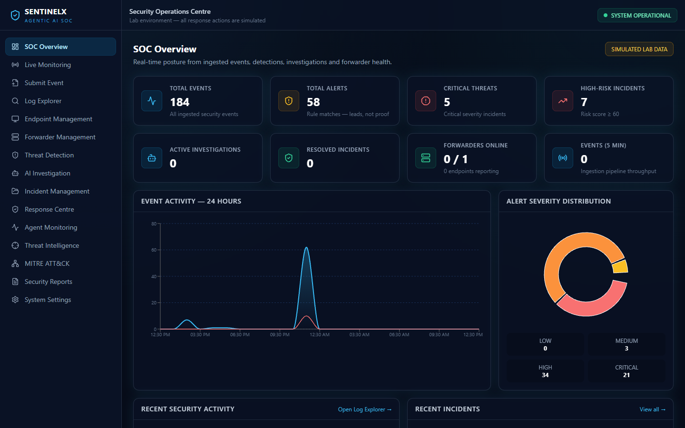
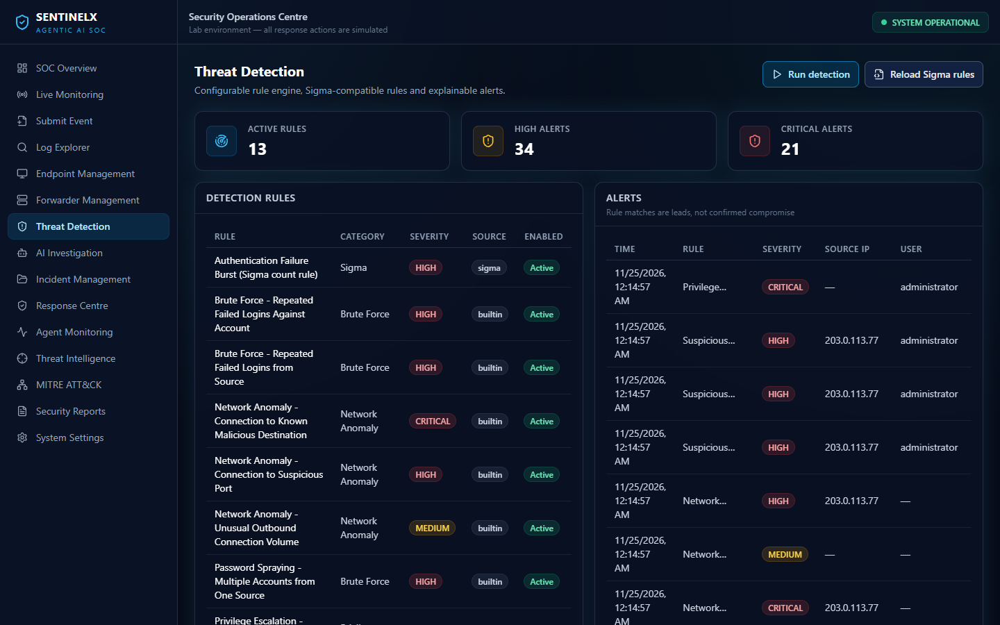
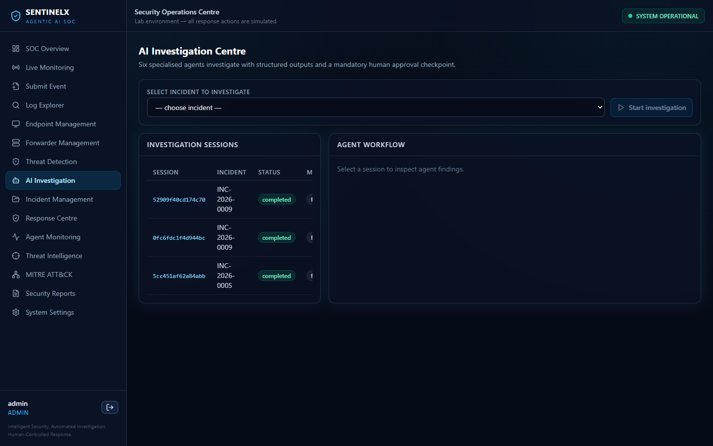
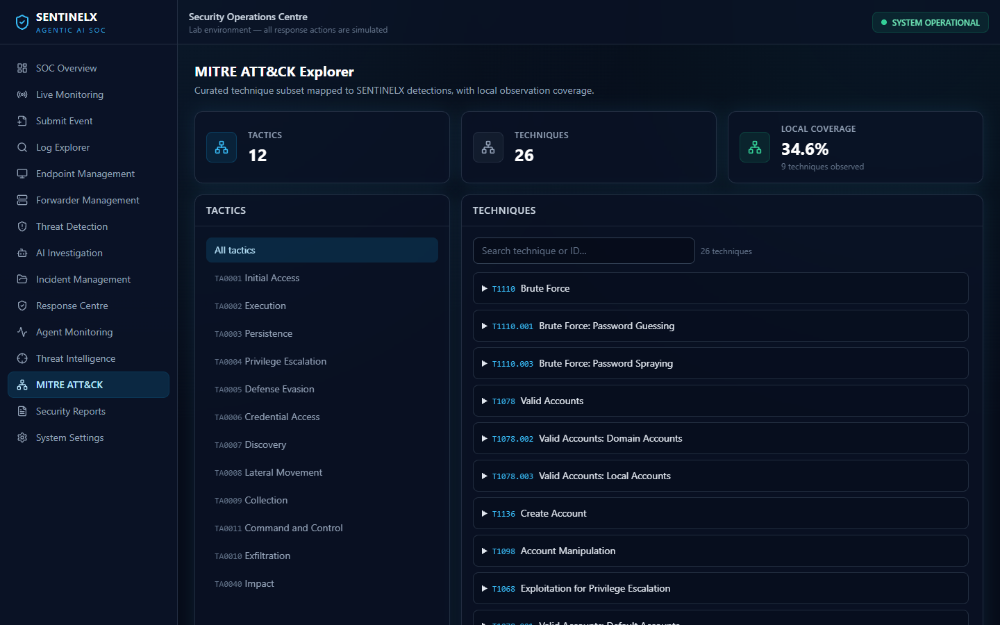

# SENTINELX — Agentic AI SOC Analyst

**Intelligent Security. Automated Investigation. Human-Controlled Response.**

A defensive, portfolio-ready SOC platform that collects Windows/Linux security logs, detects threats, correlates events, runs specialised AI agents, and requires a human decision before response.

> **Safety:** Lab-oriented. Bundled data and response actions are simulated. No external systems are attacked, no shell commands are executed by AI, and real integrations are opt-in.

## Screenshots

| | |
| --- | --- |
|  |  |
| **SOC Overview** — live KPIs, charts, incidents | **Threat Detection** — rules, alerts, evidence |
|  |  |
| **AI Investigation** — six agents, approval gate | **MITRE ATT&CK** — techniques and local coverage |

Full gallery: [`docs/screenshots/`](docs/screenshots/) (12 real dashboard captures).

## What it does

1. **Collect** — SXUF forwarder reads only configured Windows Event Logs (4624, 4625, 4672, 4688, …), Linux `auth.log`/`syslog`/journald, and optional Wazuh alerts.
2. **Normalise** — one common event schema with stable IDs, UTC timestamps, deduplication and enrichment.
3. **Detect** — configurable rules + Sigma subset: brute force, spraying, suspicious logins, privilege escalation, processes, network anomalies.
4. **Correlate** — related events become a single incident with timeline, evidence and MITRE mapping.
5. **Score** — deterministic 0–100 risk score with an explainable breakdown.
6. **Investigate** — six LangGraph agents (log analysis, threat detection, investigation, risk, response, report).
7. **Approve** — the graph pauses; only an authenticated human can approve/reject. Execution is simulated.
8. **Report** — PDF and JSON exports with SHA-256 hashes and a full audit trail.

## Key features

- **15-page React dashboard** — React + TypeScript + Tailwind + Recharts + Lucide, dark SOC theme.
- **SXUF forwarder** — disk buffer, retry/backoff, dedupe, heartbeat, HTTPS + scoped hashed agent keys, Windows service / systemd install guides.
- **Log Explorer** — SIEM query syntax (`user:admin -action:success`), filters, saved searches, raw/normalised inspection.
- **Submit Event** — paste a log and auto-run detection + correlation in one click.
- **Three roles** — Administrator, SOC Analyst, read-only Security Viewer; bcrypt + JWT + RBAC.
- **MITRE ATT&CK Explorer** — curated 12 tactics / 26 techniques with local coverage.
- **Optional integrations** — PostgreSQL, Redis, Elasticsearch, Wazuh, VirusTotal, AbuseIPDB, LLM API — all with documented fallbacks.

## Stack

Python 3.12 · FastAPI · Pydantic · SQLAlchemy · Alembic · LangGraph · React 18 · TypeScript · Tailwind · Recharts · SQLite (PostgreSQL optional) · Docker Compose

## Quick start

```powershell
cd "C:\Users\sandr\OneDrive\Documents\Default Project\sentinelx"
python -m pip install -r requirements.txt
python scripts/init_db.py
python run.py
```

Open **http://localhost:8000** → login `admin` / `Admin@123!` or `analyst` / `Analyst@123!`.

React dashboard (optional — built output is served by FastAPI):

```powershell
cd frontend
npm install
npm run build
```

Windows forwarder setup: `scripts/setup_sxuf_windows.ps1`, then `python sxuf.py run` from `forwarder/`.

## Pages

SOC Overview · Live Monitoring · Submit Event · Log Explorer · Endpoint Management · Forwarder Management · Threat Detection · AI Investigation · Incident Management · Response Centre · Agent Monitoring · Threat Intelligence · MITRE ATT&CK · Security Reports · System Settings

## Tests

```powershell
python -m pytest -q
```

**75 passing**, including forwarder unit tests and a forwarder → ingestion → detection end-to-end test.

## Documentation

- [Architecture](docs/ARCHITECTURE.md)
- [Forwarder design & installation](docs/FORWARDER.md)
- [Search syntax](docs/SEARCH_SYNTAX.md)
- [Lab & test scenarios](docs/LAB.md)
- [Publishing to GitHub](docs/GITHUB.md)
- [Full previous README](docs/README-full.md)

## Limitations

Curated MITRE subset (not full ATT&CK), in-process rate limiting by default, real Wazuh/Elasticsearch/LLM/response integrations require your own configuration, and the Windows native Event Log backend was not exercised on a live Windows service in CI. No fabricated metrics or screenshots.

**Attribution:** Educational/portfolio project. Use only with systems and data you are authorised to monitor.
