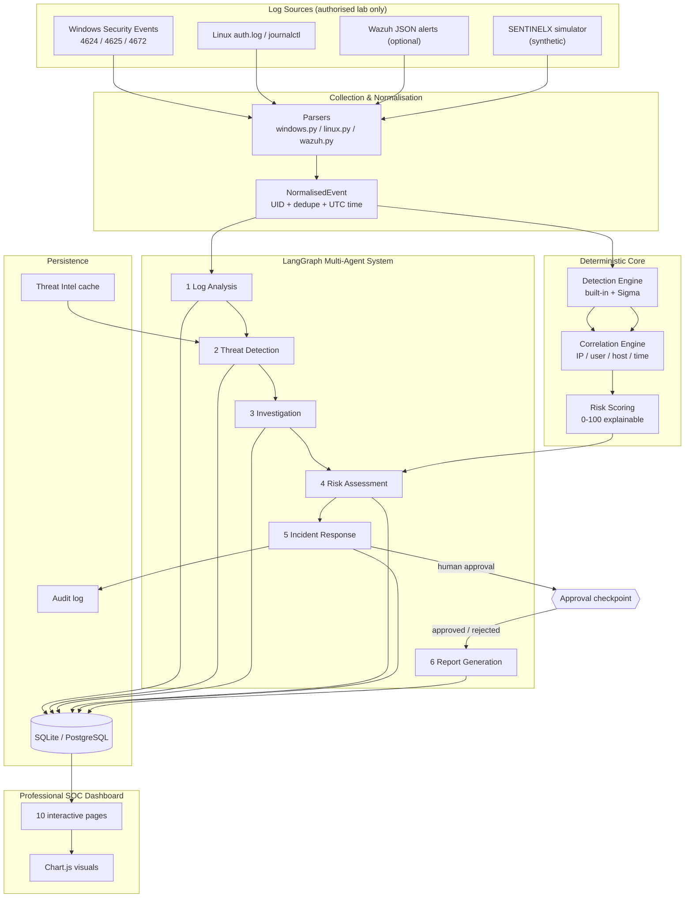
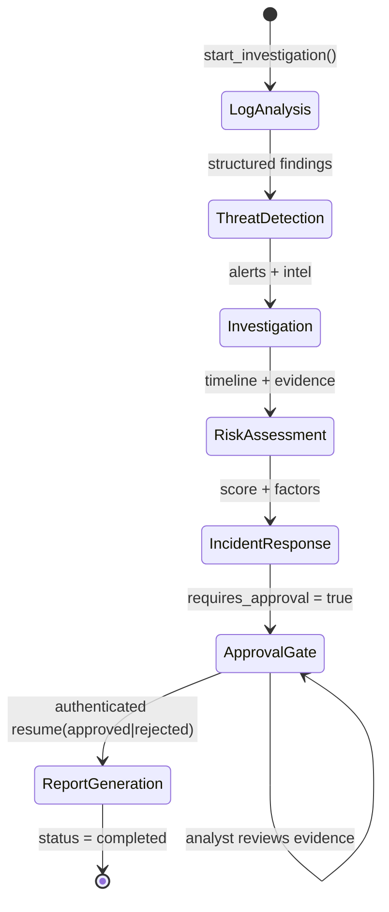

# SENTINELX — Agentic AI SOC Analyst

**An advanced, fully functional Agentic AI Security Operations Center for portfolio demonstrations, technical interviews and lab-based security training.**

> **Safety notice:** SENTINELX is a defensive, lab-oriented platform. All bundled logs, intelligence hits and response executions are *simulated*. It never attacks external systems, never executes AI-generated shell commands, and never performs real containment actions. Real Wazuh, Elasticsearch, VirusTotal, AbuseIPDB or LLM integrations are optional and disabled by default.

---

## Table of contents

1. [Overview](#1-overview)
2. [Problem statement & objectives](#2-problem-statement--objectives)
3. [Key features](#3-key-features)
4. [Technology stack](#4-technology-stack)
5. [Architecture](#5-architecture)
6. [Multi-agent investigation workflow](#6-multi-agent-investigation-workflow)
7. [Project structure](#7-project-structure)
8. [Installation](#8-installation)
9. [Configuration](#9-configuration)
10. [Usage](#10-usage)
11. [API documentation](#11-api-documentation)
12. [Screenshots](#12-screenshots)
13. [Testing](#13-testing)
14. [Security considerations](#14-security-considerations)
15. [Implementation notes & limitations](#15-implementation-notes--limitations)
16. [Future enhancements](#16-future-enhancements)
17. [GitHub publication](#17-github-publication)

---

## 1. Overview

SENTINELX simulates the workflow of a real Security Operations Center end to end:

1. **Collect** Windows Security events (4624, 4625, 4672), Linux `auth.log`/`journalctl` events, Wazuh alerts and synthetic lab events.
2. **Normalise** every record into a common schema with a stable duplicate-resistant event UID.
3. **Detect** brute force, password spraying, suspicious logins, network anomalies, suspicious processes and privilege escalation with configurable rules (plus a documented Sigma-compatible subset).
4. **Correlate** related events by source IP, account, host and time into potential incidents with visible evidence and MITRE ATT&CK mappings.
5. **Score** risk deterministically on a 0–100 scale with every contributing point explained.
6. **Investigate** with five specialised LangGraph agents that share a structured investigation state.
7. **Recommend** response actions, then **pause for a human analyst decision** before anything is marked approved. Execution remains simulated.
8. **Report** with a branded, downloadable PDF containing timelines, evidence hashes, agent findings and approval history.
9. **Visualise** everything through a premium, responsive dark SOC dashboard with ten pages and real database-backed statistics.

### What makes the AI agentic (and still safe)

- Agents are **specialised**, communicate through a **shared typed state**, and are orchestrated by a **LangGraph state graph** with conditional routing and a genuine approval checkpoint.
- Every agent response is **structured output validated with Pydantic**. If validation or the API fails, a deterministic, evidence-based fallback is used and the failure is recorded.
- The LLM **never decides whether an attack occurred**, never sets the risk score, and never chooses or executes a response action. Those decisions come from deterministic code; the LLM only phrases explanations.
- Without an API key the whole system runs in a clearly labelled **fallback / deterministic mode**.

---

## 2. Problem statement & objectives

### Problem

SOC teams are overwhelmed by raw log volume. Manual triage is slow, inconsistent and hard to explain. Purely LLM-driven "AI SOC" tools are risky: they can hallucinate evidence, cannot be audited, and may take consequential actions without human approval.

### Objectives

| Objective | How SENTINELX addresses it |
| --- | --- |
| Collect heterogeneous Windows/Linux logs | Format-specific parsers → one normalised schema |
| Detect attacks reliably | Transparent rule engine with configurable thresholds; Sigma subset |
| Explain why something is suspicious | Every alert and score includes evidence and contributing factors |
| Correlate events into incidents | Source/IP/user/host/time clustering with timelines and MITRE mapping |
| Use specialised AI agents safely | Five LangGraph agents, structured outputs, deterministic fallbacks |
| Keep humans in control | Mandatory approval checkpoint; simulated execution; audit trail |
| Produce investigation artefacts | PDF reports with hashes, timelines and approvals |
| Work without paid services | Local rules, simulated data, template fallback, SQLite by default |

---

## 3. Key features

- **Overview dashboard** — events, alerts, critical threats, high-risk incidents, active investigations, resolved incidents, severity doughnut, hourly activity line chart, agent status, recent events and incident summaries.
- **Live monitoring** — auto-refreshing (6 s) filterable event stream with manual detection/correlation triggers.
- **Threat detection** — enable/disable and tune rules, reload Sigma rules, run detection, browse explainable alerts.
- **AI investigation centre** — incident selector, visual workflow, agent-by-agent findings, evidence basis, approval checkpoint and resume.
- **Incident management** — statuses (`New`, `Investigating`, `Pending Approval`, `Contained`, `Resolved`, `False Positive`), evidence, risk factors, timeline, MITRE techniques, audit trail.
- **Incident response centre** — pending/approved/rejected recommendations, analyst identity, reason, timestamps, role checks (high-impact actions require admin), simulated execution only.
- **AI agent monitoring** — real execution counts, successes, failures, durations, last run and recent history (never fabricated).
- **Threat intelligence** — optional VirusTotal and AbuseIPDB lookups for IP/domain/MD5/SHA-1/SHA-256, caching, rate-limit handling, and explicit `unknown` results.
- **Security reports** — generated PDFs with SENTINELX branding and SHA-256 hash recorded in the database.
- **System settings** — runtime/integration status, safe lab simulation scenarios, users (admin) and audit log.
- **Authentication & RBAC** — bcrypt password hashing, JWT bearer tokens, role-protected endpoints, login rate limiting, account lockout, audit logging, input validation, CSP and security headers.
- **Docker support** — Dockerfile, compose file with optional PostgreSQL and Elasticsearch profiles.

---

## 4. Technology stack

| Layer | Technology |
| --- | --- |
| Backend | Python 3.10+, FastAPI, Uvicorn, REST |
| Data | SQLAlchemy 2.0, SQLite (default), PostgreSQL-compatible models, Alembic migrations, optional Elasticsearch |
| AI | LangGraph `StateGraph`, Pydantic structured outputs, OpenAI-compatible chat API (optional), deterministic fallback |
| Security | bcrypt, PyJWT, role-based access control, rate limiting, audit log, CSP |
| Detection | Custom rule engine, Sigma-compatible subset, MITRE ATT&CK mapping |
| Intelligence | VirusTotal v3, AbuseIPDB v2 (optional), cached verdicts |
| Reporting | ReportLab PDF |
| Frontend | HTML5, CSS3, vanilla JavaScript, Chart.js (vendored locally) |
| Testing | Pytest, FastAPI TestClient |
| Deployment | Docker, Docker Compose |

---

## 5. Architecture



### Design principles

- **Grounding before generation.** All agent inputs are collected by deterministic code from the database.
- **Reproducibility.** Risk scores and detection alerts are pure functions of stored events; reruns do not duplicate alerts.
- **Fail open safely.** Missing API keys or failed LLM calls degrade to labelled fallback mode, never to silent "clean" verdicts.
- **Portability.** SQLAlchemy generic types keep the same models working on SQLite and PostgreSQL.

---

## 6. Multi-agent investigation workflow



| Agent | Role | Grounded inputs | Output |
| --- | --- | --- | --- |
| Log Analysis | Normalise and extract fields | Collected events | Key fields, patterns, structured summary |
| Threat Detection | Evaluate rule matches | Alerts + threat intel | Categories, preliminary severity, explanation |
| Investigation | Correlate and build timeline | Events + alerts | Affected users/systems, correlation explanation, MITRE |
| Risk Assessment | Compute deterministic score | Alerts, events, intel | 0–100 score, severity, factors |
| Incident Response | Recommend actions | Risk + events | Whitelisted recommendations, approval request |
| Report Generation | Produce report narrative | All above | Executive summary, remediation |

**Approval checkpoint.** The LangGraph conditional edge routes to `wait_for_approval` when `requires_approval` is set and no decision exists. The graph stays paused; only the authenticated `POST /api/investigations/{uid}/resume` endpoint can supply a decision and resume into `execute_response → report_generation`. No shell command, firewall call or account change is ever executed.

---

## 7. Project structure

```text
sentinelx/
├── README.md                     # this document
├── requirements.txt              # runtime dependencies
├── requirements-dev.txt          # pytest / ruff
├── .env.example                  # documented configuration template
├── .gitignore                    # secrets, DBs, logs and venvs excluded
├── Dockerfile
├── docker-compose.yml            # optional postgres / elastic profiles
├── .dockerignore
├── alembic.ini
├── run.py                        # local startup
├── pytest.ini
├── app/
│   ├── main.py                   # FastAPI app, middleware, static UI
│   ├── config.py                 # environment settings / public config
│   ├── database.py               # engine, sessions, init_db
│   ├── models.py                 # 16 SQLAlchemy models
│   ├── schemas.py                # Pydantic request schemas
│   ├── security.py               # bcrypt, JWT, RBAC, rate limiting
│   ├── api/
│   │   ├── __init__.py           # aggregated /api router
│   │   └── routes/               # 12 route modules
│   ├── collectors/               # windows, linux, wazuh, normaliser
│   ├── detection/                # engine, rules, sigma, types, loader
│   ├── correlation/              # engine, MITRE mapping
│   ├── risk/                     # deterministic scoring
│   ├── agents/                   # state, tools, LLM, 6 nodes, orchestrator
│   ├── threat_intel/             # providers, cache, service
│   ├── reports/                  # ReportLab PDF generation
│   ├── services/                 # audit, seed, simulation
│   ├── integrations/             # optional Elasticsearch client
│   ├── utils/                    # time, hashing, indicators
│   └── static/                   # HTML / CSS / JS / vendored Chart.js
├── data/
│   ├── samples/                  # labelled simulated Windows/Linux/Wazuh logs
│   ├── sigma/                    # working Sigma-compatible rules
│   └── reports/                  # generated PDFs (gitignored)
├── migrations/                   # Alembic initial schema
├── scripts/                      # init_db.py, seed.py
└── tests/                        # 42 automated tests
```

---

## 8. Installation

### Prerequisites

- Python 3.10+ (tested on 3.12)
- pip
- Optional: Docker + Docker Compose

### Local (beginner friendly)

```bash
# 1. Enter the project
cd sentinelx

# 2. Create an isolated environment
python -m venv .venv
# Windows:
.venv\Scripts\activate
# macOS / Linux:
source .venv/bin/activate

# 3. Install dependencies
python -m pip install --upgrade pip
pip install -r requirements.txt

# 4. Create your configuration (no secrets are required)
copy .env.example .env        # Windows
# cp .env.example .env        # macOS / Linux

# 5. Initialise the database with safe demo data
python scripts/init_db.py

# 6. Start the application
python run.py
```

Open **http://localhost:8000**. The interactive API documentation is at **http://localhost:8000/api/docs**.

Default lab accounts (change these before any real deployment):

| Username | Password | Role |
| --- | --- | --- |
| `admin` | `Admin@123!` | Administrator |
| `analyst` | `Analyst@123!` | Analyst |

### Docker

```bash
# Basic app (no external services required)
docker compose up --build

# Optional: PostgreSQL
docker compose --profile postgres up

# Optional: Elasticsearch
docker compose --profile elastic up
```

---

## 9. Configuration

All configuration is read from environment variables (or a local `.env` file). See `.env.example` for the complete list. **Never commit `.env`.**

### Core settings

| Variable | Default | Purpose |
| --- | --- | --- |
| `DATABASE_URL` | `sqlite:///./data/sentinelx.db` | SQLAlchemy URL; works with PostgreSQL too |
| `SECRET_KEY` | dev placeholder | JWT signing key — **replace in production** |
| `ACCESS_TOKEN_EXPIRE_MINUTES` | `60` | Bearer token lifetime |
| `SEED_DEMO_DATA` | `true` | Seed labelled simulated logs/alerts/incidents on first start |
| `LOGIN_RATE_LIMIT` / `LOGIN_RATE_WINDOW_SECONDS` | `5` / `60` | Failed-login throttling |
| `BRUTE_FORCE_WINDOW_SECONDS` / `BRUTE_FORCE_THRESHOLD` | `300` / `5` | Detection defaults (also editable per rule) |
| `RESPONSE_EXECUTION_ENABLED` | `false` | Reserved for future gated execution; currently always simulated |

### Optional AI provider

```dotenv
LLM_API_KEY=your-key
LLM_BASE_URL=https://api.openai.com/v1
LLM_MODEL=gpt-4o-mini
```

Leave `LLM_API_KEY` empty to run in deterministic fallback mode. Any OpenAI-compatible endpoint that supports `response_format=json_object` works.

### Optional threat intelligence

```dotenv
VIRUSTOTAL_API_KEY=your-key
ABUSEIPDB_API_KEY=your-key
```

API keys are never exposed by the API. Lookups time out, respect rate limits by reporting `unknown`, and are cached. **No file or log content is uploaded to third parties.**

### Optional Elasticsearch / Wazuh

```dotenv
ELASTICSEARCH_URL=http://localhost:9200
ELASTICSEARCH_INDEX=sentinelx-events
ELASTICSEARCH_API_KEY=...
WAZUH_URL=https://wazuh.example:55000
WAZUH_USER=...
WAZUH_PASSWORD=...
```

Both integrations are inert unless configured and explicitly invoked.

---

## 10. Usage

### Quick demo walkthrough

1. Sign in as `analyst` (or `admin`).
2. **Overview** — inspect real KPIs and the simulated-data label.
3. **Live Monitoring** — watch the auto-refreshing feed; run detection manually.
4. **Threat Detection** — toggle a rule or change its threshold via the API, then rerun detection.
5. **AI Investigation Centre** — select an incident and start an investigation. Watch the six-step workflow, read each agent's evidence-based findings, then record an approval/rejection.
6. **Incident Response Centre** — as `admin`, approve a high-impact recommendation (simulated only); as `analyst`, try to approve one and observe the 403 role check.
7. **Security Reports** — generate and download a PDF for an incident.
8. **System Settings** — run a safe simulation scenario and inspect the audit log.

### Collecting real-format logs manually

Paste log text into the API (never a real production system without authorisation):

```bash
# Windows EVTX XML / text summaries
curl -X POST http://localhost:8000/api/collect/windows/text \
  -H "Authorization: Bearer $TOKEN" -H "Content-Type: application/json" \
  -d '{"text":"2026-11-19T08:10:19Z EventID=4625 Account Name=admin Source Network Address=203.0.113.77 Computer=WIN-01 failed"}'

# Linux auth.log lines
curl -X POST http://localhost:8000/api/collect/linux/text \
  -H "Authorization: Bearer $TOKEN" -H "Content-Type: application/json" \
  -d '{"text":"Nov 19 08:41:03 host sshd[1]: Failed password for invalid user admin from 198.51.100.23 port 1 ssh2"}'
```

To obtain a token:

```bash
curl -X POST http://localhost:8000/api/auth/login \
  -H "Content-Type: application/json" \
  -d '{"username":"admin","password":"Admin@123!"}'
```

### Database migrations

```bash
python -m alembic upgrade head
python -m alembic revision --autogenerate -m "describe change"
```

Development also calls `create_all()` on startup so a fresh clone works without running Alembic first.

---

## 11. API documentation

Swagger UI: `http://localhost:8000/api/docs` · OpenAPI JSON: `/api/openapi.json`

| Method | Endpoint | Access | Description |
| --- | --- | --- | --- |
| POST | `/api/auth/register` | Admin | Create a user |
| POST | `/api/auth/login` | Public | Obtain JWT bearer token |
| GET | `/api/auth/me` | Analyst+ | Current user |
| POST | `/api/auth/logout` | Analyst+ | Audit logout (stateless token) |
| GET | `/api/dashboard/stats` | Analyst+ | KPI statistics |
| GET | `/api/dashboard/activity?hours=24` | Analyst+ | Hourly activity series |
| GET | `/api/dashboard/recent` | Analyst+ | Recent events and incidents |
| GET | `/api/events` | Analyst+ | Filterable, paginated events |
| POST | `/api/events` / `/api/events/batch` | Analyst+ | Ingest normalised events |
| POST | `/api/collect/windows/text` | Analyst+ | Parse and store Windows logs |
| POST | `/api/collect/linux/text` | Analyst+ | Parse and store Linux logs |
| POST | `/api/collect/wazuh/text` | Analyst+ | Parse and store Wazuh alerts |
| POST | `/api/collect/sample` | Analyst+ | Load a bundled lab sample |
| GET | `/api/detection/rules` | Analyst+ | List rules |
| PATCH | `/api/detection/rules/{id}` | Admin | Enable/disable or tune a rule |
| POST | `/api/detection/sigma/reload` | Admin | Reload bundled Sigma rules |
| POST | `/api/detection/run` | Analyst+ | Run all detection rules |
| GET | `/api/alerts` | Analyst+ | List explainable alerts |
| GET | `/api/incidents` | Analyst+ | List incidents |
| GET | `/api/incidents/{id}` | Analyst+ | Full incident detail with audit trail |
| PATCH | `/api/incidents/{id}` | Analyst+ | Update status/notes |
| POST | `/api/incidents/correlate` | Analyst+ | Run correlation |
| POST | `/api/investigations/start` | Analyst+ | Start LangGraph investigation |
| GET | `/api/investigations/{uid}` | Analyst+ | Session state + executions |
| POST | `/api/investigations/{uid}/resume` | Analyst+ | Approve/reject and resume graph |
| GET | `/api/response/recommendations` | Analyst+ | Response actions |
| POST | `/api/response/recommendations/{id}/approve` | Analyst+* | Approve (*admin for high impact) |
| POST | `/api/response/recommendations/{id}/reject` | Analyst+ | Reject |
| GET | `/api/agents` | Analyst+ | Agent monitoring statistics |
| GET | `/api/agents/{key}/executions` | Analyst+ | Execution history |
| POST | `/api/threat-intel/lookup` | Analyst+ | Optional reputation lookup |
| POST | `/api/reports/generate/{incident}` | Analyst+ | Generate PDF |
| GET | `/api/reports/{incident}/download` | Analyst+ | Download PDF |
| GET | `/api/simulation/scenarios` | Analyst+ | Lab scenarios |
| POST | `/api/simulation/run` | Analyst+ | Generate synthetic events |
| GET | `/api/settings`, `/api/health`, `/api/audit`, `/api/users` | Analyst+/Admin | Config, health, audit, users |

All protected endpoints expect `Authorization: Bearer <token>`.

---

## 12. Screenshots

Screenshots should be captured from the running application and stored in `docs/screenshots/`:

| Page | Suggested file |
| --- | --- |
| Overview Dashboard | `docs/screenshots/01-overview.png` |
| Live Monitoring | `docs/screenshots/02-monitoring.png` |
| AI Investigation Centre | `docs/screenshots/03-investigation.png` |
| Incident Response Centre | `docs/screenshots/04-response.png` |
| AI Agent Monitoring | `docs/screenshots/05-agents.png` |

> This repository intentionally does not embed fabricated screenshots. Generate them by running the app and capturing the pages above, then reference them here.

---

## 13. Testing

```bash
pip install -r requirements-dev.txt
pytest
pytest --cov=app --cov-report=html   # optional coverage report
```

**Verified result:** `42 passed` on Python 3.12 / Windows, using an isolated temporary SQLite database.

Coverage includes:

- Windows XML/text parsing, Linux auth parsing, Wazuh alerts, duplicate detection
- Timestamp normalisation, indicator classification, canonical hashing
- Built-in detection rules, Sigma parsing/count rules, idempotent alert creation
- Deterministic risk scoring and reproducibility
- Correlation, incident creation, evidence hashes, MITRE mapping
- Agent structured-output validation and the full LangGraph investigation with human approval
- Incident CRUD and audit trail
- Approval workflow, role checks and double-decision protection
- Password hashing, login, rate limiting, RBAC, registration
- Dashboard, event collection, simulation, threat intel fallback, PDF generation/download, static UI

### Safe simulation scenarios

`POST /api/simulation/run` supports:

1. `brute_force_login`
2. `login_after_failures`
3. `suspicious_privileged_activity`
4. `unusual_network_connections`
5. `suspicious_process_execution`
6. `correlated_attack` (full chain)

Every generated event has `source_type = "simulation"`. No external host is contacted.

---

## 14. Security considerations

- **Secrets** — only environment variables; `.env` is gitignored; public config endpoint never returns keys.
- **Passwords** — bcrypt with a SHA-256 pre-hash to avoid bcrypt's 72-byte truncation; account lockout after repeated failures; per-IP/username login rate limiting.
- **Sessions** — short-lived JWT bearer tokens in `Authorization` headers. Bearer tokens are not sent automatically with cross-site requests, which avoids classic cookie-based CSRF; CSP, `X-Content-Type-Options`, `X-Frame-Options`, `Referrer-Policy` and `Permissions-Policy` headers are set.
- **Injection** — SQLAlchemy ORM only (parameterised queries); no string-built SQL. UI escapes all untrusted values via `esc()` before injecting HTML.
- **Authorisation** — analyst/admin roles enforced on every protected route; high-impact response actions require admin; analysts must use their own identity when recording decisions. Agents cannot bypass these checks because they never call response APIs.
- **Untrusted input** — pasted logs, external intel and LLM text are treated as data, never instructions or code. No `eval`, no shell execution, no subprocess calls.
- **Response safety** — all execution is simulated; `RESPONSE_EXECUTION_ENABLED` is a placeholder for a future gated design and is false by default.
- **Data hygiene** — real logs, databases, reports and `.env` are gitignored; bundled samples are clearly labelled simulated.
- **Authorisation for collection** — only parse logs you are authorised to handle. The API deliberately does not read arbitrary filesystem paths.

For production use: replace the default `SECRET_KEY`, disable demo seeding, rotate default passwords, put the app behind HTTPS, use PostgreSQL with network isolation, and add a shared rate-limit store (Redis).

---

## 15. Implementation notes & limitations

These are deliberate, documented limitations — not unfinished placeholders:

1. **LLM mode** — without `LLM_API_KEY`, all agents use deterministic templates and report `llm_mode = "fallback"`. With a key, only wording is generated; score/decision logic stays deterministic.
2. **Sigma subset** — supports field equality, `contains`/`startswith`/`endswith`, `and` conditions and `count() >|>=|<|<=|= N [by field]` with `timeframe`. Other Sigma features are rejected with a clear error rather than silently ignored.
3. **Syslog year** — classic syslog lines have no year; the parser uses the current year. EVTX and journalctl timestamps include the year.
4. **Elasticsearch / Wazuh** — optional clients exist and are tested structurally; live connections require your own infrastructure and credentials and are not exercised by the test suite.
5. **Real-time collection** — the dashboard polls the database; there is no persistent agent daemon. Wazuh API fetching is available via an explicit endpoint.
6. **Rate limiting** — in-process for login; use Redis/API gateway for multi-worker production deployments.
7. **PDF** — generated with ReportLab; the file hash is stored in the database after generation (a PDF cannot contain its own final hash).
8. **Windows compatibility shim** — some managed Windows machines block unsigned native Python extensions. The project pins SQLAlchemy `< 2.1` and ships a tiny pure-Python `ormsgpack` compatibility shim for LangGraph's serializer, so the app still runs. On normal machines the real extension is used automatically.
9. **Browser screenshots** — not bundled (see §12); all functional tests are automated.
10. **PostgreSQL** — models and migrations are compatible, but the automated suite runs on SQLite; a live PostgreSQL instance was not available in the build environment.

---

## 16. Future enhancements

- Persistent LangGraph checkpointer (Postgres/Redis) for resumable investigations across restarts
- WebSocket/SSE streaming of agent progress instead of polling
- More Sigma modifiers and correlation rules; threat-hunting queries
- MITRE ATT&CK navigator layer export
- Case management with analyst assignments, comments and SLA timers
- Signed, tamper-evident evidence bundles
- Gated, allow-listed real response connectors behind separate approval and mTLS
- Multi-tenancy and SCIM/SSO integration
- Kubernetes manifests and Helm chart

---

## 17. GitHub publication

SENTINELX lives in its own subfolder so it can be published independently of any other project in the parent directory. For a Windows step-by-step (including installing Git, the secret pre-flight check and pushing), see [`docs/GITHUB.md`](docs/GITHUB.md).

### 1. Check what will be committed

```bash
cd sentinelx
git status
```

Confirm that `.env`, `*.db`, `data/reports/`, `__pycache__`, `.venv/` and real logs are **not** listed (they are gitignored).

### 2. Initialise and push

```bash
git init
git add .
git commit -m "feat: SENTINELX agentic AI SOC analyst platform"
git branch -M main
git remote add origin https://github.com/<your-username>/sentinelx.git
git push -u origin main
```

### 3. Recommended repository settings

- Add topics: `security`, `soc`, `blue-team`, `fastapi`, `langgraph`, `ai-agents`, `mitre-attacks`, `sigma`, `cybersecurity`.
- Protect `main`; enable Dependabot and secret scanning.
- Paste a short note in the Description linking to the live demo screenshots section.
- Keep `.env.example` updated; never commit real keys, databases, logs or virtual environments.

---

## Final delivery summary

| Item | Status |
| --- | --- |
| Professional SOC dashboard (10 pages) | Implemented |
| Windows / Linux / Wazuh log collection | Implemented (parsers + sample data) |
| Detection engine (brute force, suspicious login, network, process, privilege) | Implemented + Sigma subset |
| Five specialised agents + LangGraph orchestration | Implemented with approval checkpoint |
| Event correlation + MITRE mapping | Implemented |
| Deterministic 0–100 risk scoring | Implemented with factors |
| Incident management + audit trail | Implemented |
| Human-approved, simulated response | Implemented with RBAC |
| Threat intel integrations + caching | Implemented (optional) |
| PDF incident reports | Implemented |
| Authentication + RBAC | Implemented |
| SQLAlchemy models + Alembic migration | Implemented |
| Automated tests | 42 passing |
| Docker / Compose | Implemented |
| Documentation | This README |

**Attribution:** built as an educational/portfolio project. Use only on systems and data you are authorised to analyse.

---

## 18. Extended platform (SXUF forwarder, React SOC, ingestion gateway)

This section documents the second implementation pass. It extends — and does not replace — the verified core described above.

### What was added

| Capability | Details |
| --- | --- |
| **SXUF forwarder** | Standalone service in `forwarder/sxuf/`: Windows Event Log (pywin32 or `wevtutil`), Linux `auth.log`/`syslog` tailing, systemd journal, disk buffer, retry/backoff, dedupe ledger, heartbeats, health file, graceful shutdown. See [`docs/FORWARDER.md`](docs/FORWARDER.md), [`forwarder/install-windows.md`](forwarder/install-windows.md), [`forwarder/install-linux.md`](forwarder/install-linux.md). |
| **Central ingestion engine** | `POST /api/ingest/events`, `/api/ingest/batch`, `/api/ingest/heartbeat`, `GET /api/ingest/health`. Forwarders authenticate with scoped, hashed agent keys; keys are shown once and can be rotated or revoked. |
| **Endpoint & forwarder registry** | New `endpoints`, `forwarders`, `agent_credentials`, `ingest_receipts` tables; management APIs at `/api/endpoints`, `/api/forwarders`, `/api/agents/*`. |
| **Log Explorer** | `GET /api/events/search` with a documented query syntax, field filters, date ranges, facets, raw/normalised inspection, saved searches (`/api/searches`). See [`docs/SEARCH_SYNTAX.md`](docs/SEARCH_SYNTAX.md). |
| **React SOC dashboard** | `frontend/` — React 18, TypeScript, Tailwind, Recharts, Lucide; **15 pages** including a new **Submit Event** form. Built output is served by FastAPI at `/`; the original zero-build UI stays at `/static/index.html`. |
| **Submit Event / auto-processing** | `POST /api/events/submit` accepts raw log text or a structured event and immediately runs detection + correlation, returning created alerts and incidents. Forwarded batches are also processed automatically (`AUTO_PROCESS_FORWARDED=true`). |
| **Windows setup script** | `scripts/setup_sxuf_windows.ps1` registers the host, writes `forwarder/config.yaml` and a protected `agent.key`, and prepares continuous collection. |
| **MITRE ATT&CK Explorer** | Curated technique subset with tactics, search and local coverage at `/api/mitre/*`. Clearly labelled as a subset, not the full catalogue. |
| **Three roles** | Administrator, SOC Analyst and Security Viewer. Viewers are read-only across the API via a central write guard. |
| **Reports & retention** | JSON report export (`GET /api/reports/{incident}/json`) alongside PDF; configurable retention (`POST /api/retention`, `python scripts/retention.py`). Audits and incidents are preserved. |
| **Deployment** | Multi-stage Dockerfile builds the React SPA; Compose adds optional Redis (`--profile redis`); Alembic head `2f4a9c1d7b60` adds the new tables. |
| **Prompt-injection hardening** | LLM payloads are wrapped in explicit untrusted-data markers and the system prompt forbids following instructions found in logs/intel. |

### Updated verification

- `pytest -q` → **74 passing** (was 42), including forwarder unit tests, submit-event auto-processing and a forwarder → ingestion → detection end-to-end test.
- `npm run build` in `frontend/` → production build succeeds; FastAPI serves `frontend/dist`.
- Alembic `upgrade head` verified on a fresh SQLite database.
- The Windows native Event Log backend is implemented but was **not** exercised on a live Windows host here; the `wevtutil` fallback and cross-platform file source are unit-tested. Redis/PostgreSQL/Elasticsearch remain optional and are not required for the core pipeline.

See [`docs/ARCHITECTURE.md`](docs/ARCHITECTURE.md) and [`docs/LAB.md`](docs/LAB.md) for the full design and lab procedures.
